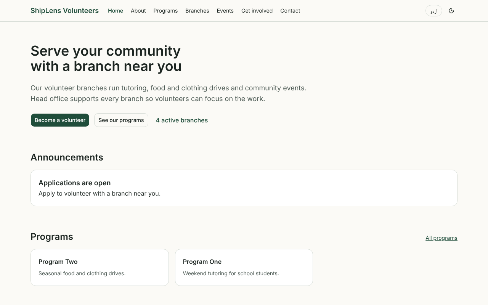
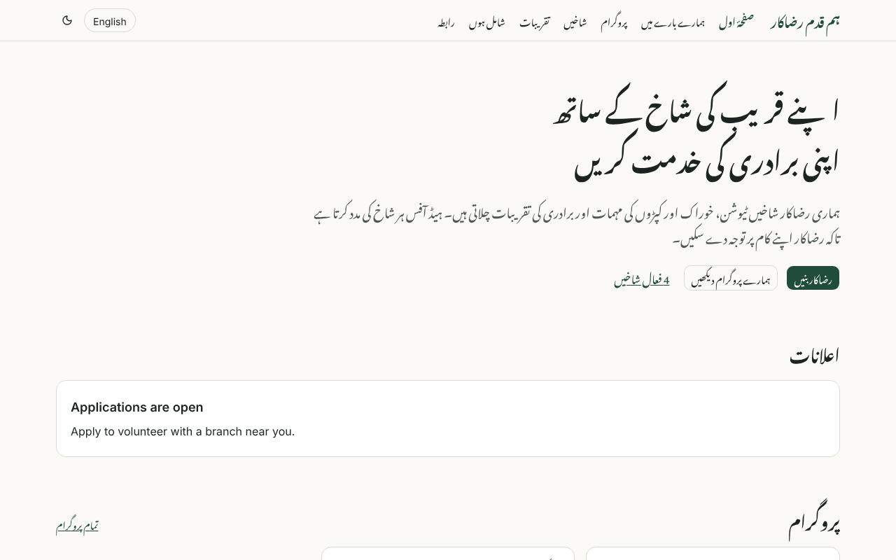
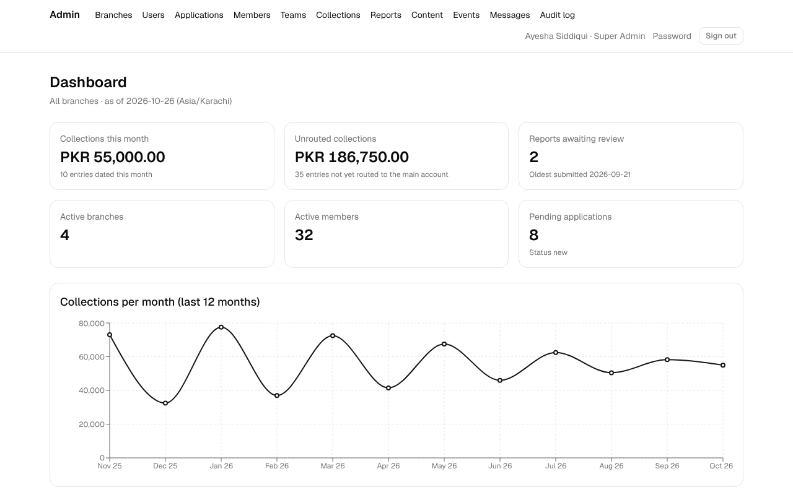
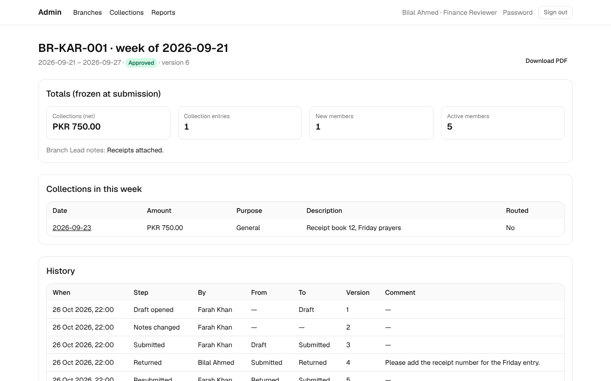
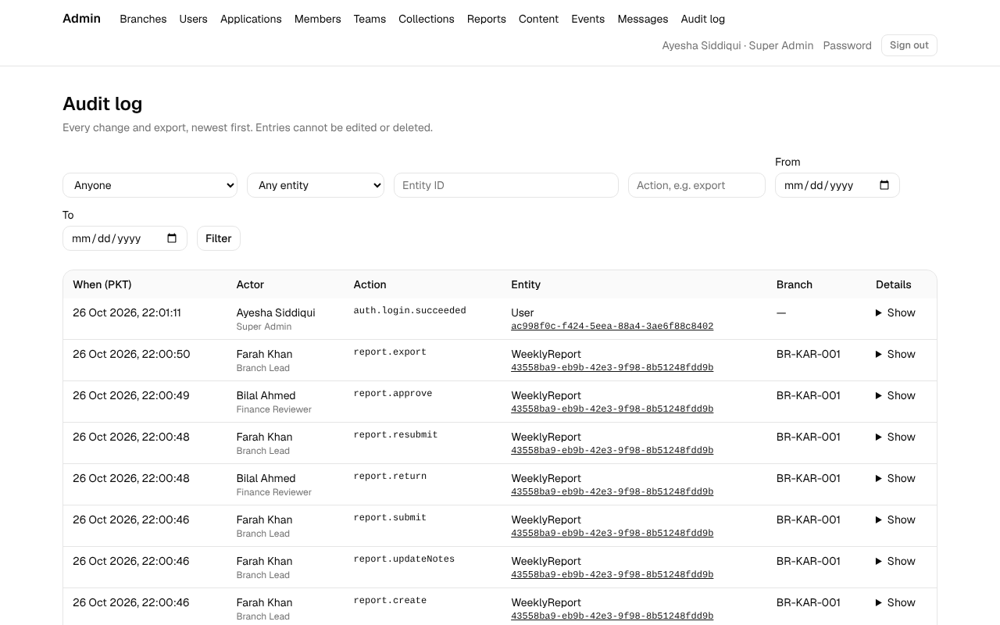

# Hamqadam: Branch-to-Head-Office Management Platform

Hamqadam connects a volunteer organisation's branches to its head office and runs its public
website. Branch Leads record collections and submit weekly reports. The Finance Reviewer
checks and approves them. HR turns volunteer applications into members. Head office sees the
whole picture on one dashboard, with every change and export kept in an audit log that cannot
be edited. It replaces spreadsheet and WhatsApp reporting with approved, auditable records.

**Live:** <https://shiplens.onrender.com>. The free plan sleeps when idle, so the first page
can take up to a minute. Staff sign in at <https://shiplens.onrender.com/admin/login>.

## Test logins

One login per role, all working on the live site:

| Role             | Email                                 | Signs in to                                                   |
| ---------------- | ------------------------------------- | ------------------------------------------------------------- |
| Super Admin      | `super.admin@demo.hamqadam.test`      | Users, branches, the dashboard and the audit log              |
| Finance Reviewer | `finance.reviewer@demo.hamqadam.test` | Weekly reports to approve or return, collections not yet sent |
| Content Editor   | `content.editor@demo.hamqadam.test`   | The content manager: drafts and publishing                    |
| HR Lead          | `hr.lead@demo.hamqadam.test`          | Volunteer applications, accepting or declining them           |
| Branch Lead      | `lead.kar001@demo.hamqadam.test`      | Karachi Central (`BR-KAR-001`): members, collections, reports |

All five share one password. It is not stored in this repository (rule 9 of the brief: no
passwords in Git); it is given with the submission and set on Render as `SEED_DEMO_PASSWORD`.
Loading the sample data is one command, `npm run db:seed`; see
[docs/handover.md](docs/handover.md#sample-data-and-demo-logins).

The specification is [`docs/SPEC.md`](docs/SPEC.md). Approved decisions are in
[`docs/OPEN-QUESTIONS.md`](docs/OPEN-QUESTIONS.md), and the acceptance record is
[`docs/ACCEPTANCE.md`](docs/ACCEPTANCE.md).

## Screenshots

| Public site (English)                                 | Public site (Urdu, right to left)                  |
| ----------------------------------------------------- | -------------------------------------------------- |
|  |  |

| Head-office dashboard                        | Weekly report with its review history                |
| -------------------------------------------- | ---------------------------------------------------- |
|  |  |



## Status

**Phases 0 to 7 are implemented**; what is left for the project owner is listed in
[`docs/ACCEPTANCE.md`](docs/ACCEPTANCE.md). Live at <https://shiplens.onrender.com>:

- Project tooling, Docker and CI, the health endpoint, and deployment on Render
- The full data model, plus database rules enforced in PostgreSQL: the 7-day collection lock,
  approved-week checks, correction limits, an append-only audit log and a restricted app role
- Staff sign-in with a lockout after failed attempts and a forced first-login password change
- The role permission matrix, the audit service, and the sample-data seed
- Admin screens for branches, users, applications, members, teams, collections, weekly
  reports (with the review cycle), the dashboard, content, events, contact messages and the
  audit log
- The bilingual public site (English and Urdu, right-to-left) with the volunteer and contact
  forms
- Search and sharing: unique titles and descriptions in both languages, canonical and hreflang
  links, Open Graph and X cards, structured data, `robots.txt`, `sitemap.xml` and `llms.txt`
  (see [Search and discoverability](#search-and-discoverability))
- CSV and PDF exports scoped by role and audited, security headers with a content security
  policy, rate limits and structured logs (see [`docs/security.md`](docs/security.md))
- Tests in CI: unit and integration tests with a 60% backend coverage gate, Playwright
  end-to-end tests (each role's refusals and the full weekly report cycle) and axe checks of
  the public pages; deploys go out through a Render deploy hook once CI passes on `main`

- Documentation: ADRs, the API reference, the generated permission table, a handover with a
  runbook, the demo script and the acceptance record

[`docs/IMPLEMENTATION-CHECKLIST.md`](docs/IMPLEMENTATION-CHECKLIST.md) tracks every phase, and
[`docs/ACCEPTANCE.md`](docs/ACCEPTANCE.md) lists what is left for the project owner.

## Stack

Next.js 16 (App Router, server components and server actions) with strict TypeScript,
PostgreSQL 16 with Prisma, Auth.js v5, Zod, Tailwind CSS v4 with shadcn/ui, next-intl, Recharts
and PDFKit. Tests use Vitest and Playwright with axe. Delivery is Docker, GitHub Actions and
Render. [ADR 0001](docs/adr/0001-stack.md) has the versions and the reasons.

## Documentation

| Document                                                     | What it covers                                                       |
| ------------------------------------------------------------ | -------------------------------------------------------------------- |
| [docs/adr/](docs/adr/README.md)                              | System diagrams and the ADRs                                         |
| [docs/api.md](docs/api.md)                                   | Every server action and route handler: inputs, outputs, permissions  |
| [docs/permissions.md](docs/permissions.md)                   | Role × action table, generated from `lib/permissions.ts`             |
| [docs/handover.md](docs/handover.md)                         | Setup, environment, demo logins, deployment, runbook, limitations    |
| [docs/security.md](docs/security.md)                         | OWASP Top 10 mapping                                                 |
| [docs/sample-data-expected.md](docs/sample-data-expected.md) | Expected dashboard values for the sample data                        |
| [docs/demo-script.md](docs/demo-script.md)                   | Five-minute walkthrough outline                                      |
| [docs/ACCEPTANCE.md](docs/ACCEPTANCE.md)                     | Section 14 acceptance checklist with evidence                        |
| [docs/seo/](docs/seo/IMPLEMENTATION.md)                      | Search, social and AI discoverability: baseline, design, owner steps |
| [AI-USAGE.md](AI-USAGE.md)                                   | How AI tools were used, and what a human decided                     |
| [GEMINI.md](GEMINI.md)                                       | Frontend brief and working rules for the redesign with Gemini        |

## Prerequisites

- Node.js 24 (see `.nvmrc`) and npm
- Docker with Docker Compose, for the local PostgreSQL database

## Local setup

```bash
npm ci
cp .env.example .env      # then replace the placeholder values
docker compose up -d      # starts PostgreSQL 16 (service "db"); wait for "healthy"
npm run db:generate       # generate the Prisma client (npm ci does not)
npm run db:deploy         # apply migrations
npm run db:seed           # load sample data and demo logins (docs/handover.md)
npm run dev               # http://localhost:3000, staff sign-in at /admin/login
```

### Environment variables

| Variable                   | Used by          | Description                                              |
| -------------------------- | ---------------- | -------------------------------------------------------- |
| `DATABASE_URL`             | App, Prisma      | PostgreSQL connection string                             |
| `DATABASE_MIGRATION_URL`   | Prisma           | Optional owner connection for migrations (see handover)  |
| `AUTH_SECRET`              | App              | Session signing key, at least 32 random characters       |
| `AUTH_TRUST_HOST`          | App              | `true` behind a trusted reverse proxy                    |
| `TRUSTED_CLIENT_IP_HEADER` | App              | Header the proxy sets to the client IP (see security)    |
| `SITE_URL`                 | App              | Canonical origin (bare HTTPS); defaults to the live site |
| `TEST_DATABASE_URL`        | Tests            | Disposable database; its name must end in `_test`        |
| `E2E_DATABASE_URL`         | E2E tests        | Disposable database; its schema is reset on every run    |
| `PLAYWRIGHT_CHROMIUM_PATH` | E2E tests        | Optional path to an already installed Chromium           |
| `SEED_DEMO_PASSWORD`       | Seed             | Password for every demo login (12+ characters)           |
| `POSTGRES_USER`            | `docker compose` | Database user for the local container                    |
| `POSTGRES_PASSWORD`        | `docker compose` | Database password for the local container                |
| `POSTGRES_DB`              | `docker compose` | Database name for the local container                    |
| `POSTGRES_PORT`            | `docker compose` | Host port for PostgreSQL, bound to `127.0.0.1` (`5432`)  |
| `APP_PORT`                 | `docker compose` | Host port for the optional app container (`3000`)        |

`.env.example` contains placeholders only. Never commit `.env`. The server validates
`DATABASE_URL` and `AUTH_SECRET` at startup and exits if either is missing or invalid.

### Database

```bash
docker compose up -d           # start PostgreSQL (data persists in a named volume)
docker compose ps              # "healthy" once pg_isready succeeds
docker compose down            # stop; add -v to also delete the data volume
```

To run the production image together with the database:

```bash
docker compose --profile app up --build
```

## Scripts

| Script                     | Description                                         |
| -------------------------- | --------------------------------------------------- |
| `npm run dev`              | Generate the Prisma client and start the dev server |
| `npm run build`            | Generate the Prisma client and build for production |
| `npm run start`            | Start the production server after a build           |
| `npm run lint`             | ESLint (fails on warnings)                          |
| `npm run lint:fix`         | ESLint with automatic fixes                         |
| `npm run typecheck`        | Generate route types and run `tsc --noEmit`         |
| `npm run format`           | Format files with Prettier                          |
| `npm run format:check`     | Check formatting                                    |
| `npm run test`             | Run unit and integration tests                      |
| `npm run test:unit`        | Unit tests only                                     |
| `npm run test:integration` | Integration tests against `TEST_DATABASE_URL`       |
| `npm run test:coverage`    | Unit and integration tests with the coverage gate   |
| `npm run e2e:prepare`      | Build the app and the seed script for the E2E run   |
| `npm run test:e2e`         | Playwright end-to-end and axe tests (see handover)  |
| `npm run seo:check -- URL` | SEO audit of a running site (see below)             |
| `npm run og:images`        | Render the social preview images in `public/og/`    |
| `npm run db:seed`          | Load the sample data (safe to re-run)               |
| `npm run db:validate`      | Validate the Prisma schema                          |
| `npm run db:generate`      | Generate the Prisma client                          |
| `npm run db:format`        | Format the Prisma schema                            |
| `npm run db:migrate`       | Create and apply a migration in development         |
| `npm run db:deploy`        | Apply pending migrations                            |
| `npm run db:studio`        | Open Prisma Studio                                  |
| `npm run db:up`            | Start the PostgreSQL container                      |
| `npm run db:down`          | Stop the Docker Compose services                    |

Commits must follow [Conventional Commits](https://www.conventionalcommits.org/). A pre-commit
hook lints and formats staged files.

## Tests

| Suite       | Command                    | What it proves                                                                                                                                                                                                            |
| ----------- | -------------------------- | ------------------------------------------------------------------------------------------------------------------------------------------------------------------------------------------------------------------------- |
| Unit        | `npm run test:unit`        | Permission matrix, state machines, lock rules, codes, money, CSV escaping, validation, security headers, PDFs                                                                                                             |
| Integration | `npm run test:integration` | Every service against a real PostgreSQL: transactions, the database triggers, scope (IDOR) checks, the seed and its expected dashboard values                                                                             |
| Coverage    | `npm run test:coverage`    | Both of the above, failing below 60% of backend lines (69% at last count)                                                                                                                                                 |
| End-to-end  | `npm run test:e2e`         | Playwright on the production build: each role's 403 and 404 responses, the full weekly report cycle with its audit trail, axe on every public page in both languages and themes, clean hydration, and the SEO audit below |

CI runs all four on every push and pull request. Running the end-to-end suite locally is
described in [docs/handover.md](docs/handover.md#end-to-end-tests).

## Search and discoverability

The public pages describe themselves to search engines, social networks and AI-assisted
search with the Next.js Metadata API and next-intl; no SEO library is used.
[`docs/seo/IMPLEMENTATION.md`](docs/seo/IMPLEMENTATION.md) has the design and the reasons.

- `lib/seo/pages.ts` lists the public pages once. Metadata, `sitemap.xml`, structured data,
  `llms.txt` and the tests all read it.
- Each page has a unique title and description in its language (`metaTitle` and
  `metaDescription` in `messages/*.json`), a self-referencing canonical on `SITE_URL`,
  `en`/`ur`/`x-default` alternates, Open Graph and X cards with a per-language image
  (`public/og/`), and one JSON-LD graph (organisation, website, page, and the branches or
  upcoming events it lists).
- `robots.txt` keeps crawlers out of `/api/`. The staff area answers `noindex` in a header and a
  meta tag instead of being blocked, so crawlers can see that.
- `sitemap.xml` lists the 18 public URLs, dated from published records only.

Check a deployment with `npm run seo:check -- https://shiplens.onrender.com`. The same audit
runs in CI against the production build (`e2e/seo.spec.ts`). The owner's Search Console and
Bing steps are in [`docs/seo/POST-DEPLOYMENT.md`](docs/seo/POST-DEPLOYMENT.md).

## Health endpoint

`GET /api/health` checks the database with a real query (bounded to three seconds) and is never
cached.

| Database  | Status | Body                                   |
| --------- | ------ | -------------------------------------- |
| Reachable | `200`  | `{"status":"ok","database":"up"}`      |
| Down      | `503`  | `{"status":"error","database":"down"}` |

```bash
curl -i http://localhost:3000/api/health
```

The Docker image uses the same endpoint for its container health check.

## Docker

```bash
docker build -t hamqadam .
docker run --rm -p 3000:3000 -e DATABASE_URL="postgresql://..." -e AUTH_SECRET="..." -e AUTH_TRUST_HOST=true hamqadam
```

The image is a multi-stage build of the Next.js standalone output and runs as a non-root user.

On every start the container:

1. Applies pending migrations from `prisma/migrations` (`scripts/migrate.mjs`). The Prisma CLI
   would add about 250 MB to the image, so the runner applies the same files with `pg` and
   records them in Prisma's `_prisma_migrations` table with Prisma's checksums;
   `prisma migrate status` reads the result normally. It holds an advisory lock, runs each
   migration in a transaction, and stops on an edited or failed migration.
2. Loads the section 10 sample data when `SEED_DEMO_PASSWORD` is set (bundled
   `prisma/seed.ts`; it only creates missing rows).
3. Starts the server. If step 1 or 2 fails, the container exits instead of serving.

## Deployment (Render)

`render.yaml` is a [Render Blueprint](https://render.com/docs/blueprint-spec) for a Docker web
service (`shiplens`) and a managed PostgreSQL 16 database (`shiplens-db`), both in Singapore on
free plans. Those resource names, and the live address, date from the project's competition name;
see [Names](docs/handover.md#names). No secrets are stored in the file: `DATABASE_URL` comes from the database, and
`AUTH_SECRET` is generated by Render.

1. In the Render dashboard, choose **New → Blueprint** and connect `tehsaad/ShipLens`.
2. Select the branch to deploy (the current feature branch until the phases are merged, then
   `main`).
3. Enter a value for `SEED_DEMO_PASSWORD` (at least 12 characters) when Render asks; it is the
   password of every demo login in [docs/handover.md](docs/handover.md).
4. Review the two resources and plans, then **Apply**. Render builds the `Dockerfile`; on start
   the container applies migrations and loads the sample data, and Render waits for
   `GET /api/health` to return 200.
5. Check: `curl -i https://<service>.onrender.com/api/health` returns
   `{"status":"ok","database":"up"}`, then sign in at `/admin/login` with each demo login.

Notes:

- Commits on `main` deploy only after CI passes. The `Deploy` workflow
  (`.github/workflows/deploy.yml`) calls the service's deploy hook for the commit CI tested;
  the hook URL is the `RENDER_DEPLOY_HOOK_URL` repository secret (see
  [docs/handover.md](docs/handover.md#deployment)).
- The database accepts no connections from the internet, only from Render services.
- Free web services sleep when idle, so the first request after a pause is slow, and Render
  limits how long a free database is kept. Check Render's current free-tier terms, or change
  the plans before applying.
- Migrations run when the container starts (section 12), before the server accepts requests.
- The app connects as the database owner on Render. The migration still creates the
  restricted `shiplens_app` role when it is allowed to (see docs/handover.md); the database
  triggers protect the audit log and collection rules either way.

## History

This repository first held a static bilingual (English and Urdu) volunteer landing page, added
in pull request #1. It is preserved, with its Git history, in
[`docs/design/landing-reference/`](docs/design/landing-reference/) as a design reference.

## Credits

Hamqadam is built on open-source software. The direct dependencies and their licences, as
declared in each package:

| Area               | Packages                                                                                                                                         | Licence           |
| ------------------ | ------------------------------------------------------------------------------------------------------------------------------------------------ | ----------------- |
| Framework and UI   | Next.js, React, React DOM, next-intl, Recharts, React Hook Form, `@hookform/resolvers`, react-markdown, rehype-sanitize, Zod, tw-animate-css, cn | MIT               |
| UI components      | shadcn/ui (components copied into `components/ui`, CLI `shadcn`), Radix UI (`radix-ui`)                                                          | MIT               |
| UI components      | class-variance-authority                                                                                                                         | Apache-2.0        |
| Icons              | Lucide (`lucide-react`)                                                                                                                          | ISC               |
| Auth and passwords | Auth.js (`next-auth`)                                                                                                                            | ISC               |
| Auth and passwords | `@node-rs/argon2`                                                                                                                                | MIT               |
| Database           | Prisma (`prisma`, `@prisma/client`, `@prisma/adapter-pg`)                                                                                        | Apache-2.0        |
| Database           | node-postgres (`pg`)                                                                                                                             | MIT               |
| PDF                | PDFKit                                                                                                                                           | MIT               |
| Styling            | Tailwind CSS (`tailwindcss`, `@tailwindcss/postcss`)                                                                                             | MIT               |
| Testing            | Vitest, `@vitest/coverage-v8`                                                                                                                    | MIT               |
| Testing            | Playwright (`@playwright/test`)                                                                                                                  | Apache-2.0        |
| Testing            | axe-core for Playwright (`@axe-core/playwright`)                                                                                                 | MPL-2.0           |
| Tooling            | TypeScript                                                                                                                                       | Apache-2.0        |
| Tooling            | ESLint, `eslint-config-next`, `eslint-config-prettier`, Prettier, esbuild, tsx, Husky, lint-staged, commitlint                                   | MIT               |
| Tooling            | dotenv                                                                                                                                           | BSD-2-Clause      |
| Fonts              | Inter, Noto Nastaliq Urdu (Google Fonts, loaded with `next/font`)                                                                                | SIL Open Font 1.1 |

## License

[MIT](LICENSE)
