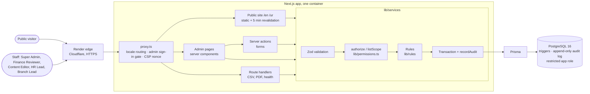
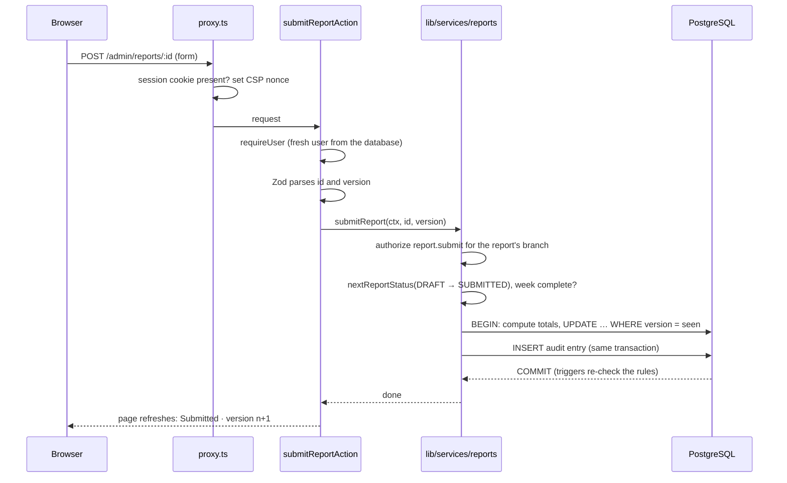
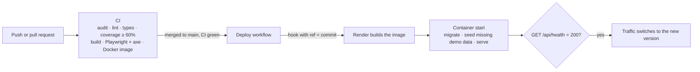

# Architecture

ShipLens is one Next.js application backed by one PostgreSQL database. It serves:

- **a public site** in English and Urdu, cached and revalidated;
- **an admin area for five staff roles**, rendered on the server per request;
- **exports and a health check**, as route handlers.

Business rules sit in a service layer that every entry point goes through. PostgreSQL then
enforces the rules that matter most a second time.

## System

## One request

A Branch Lead submits a weekly report:

## Delivery

## Decisions

| ADR                                  | Decision                                                            |
| ------------------------------------ | ------------------------------------------------------------------- |
| [0001](0001-stack.md)                | Technology stack                                                    |
| [0002](0002-authentication.md)       | Auth.js credentials, Argon2id, JWT sessions read fresh each request |
| [0003](0003-permission-model.md)     | One permission matrix; 403 outside a role, 404 outside a branch     |
| [0004](0004-audit-design.md)         | Append-only audit log written in the same transaction               |
| [0005](0005-collection-lock.md)      | Collection lock and corrections, enforced in app and database       |
| [0006](0006-report-state-machine.md) | Weekly report state machine with optimistic locking                 |
| [0007](0007-i18n.md)                 | English and Urdu with next-intl, RTL and per-locale fonts           |
| [0008](0008-deployment.md)           | Standalone image, migrations at start, CI-gated deploy hook         |
| [0009](0009-pdf-generation.md)       | PDFKit instead of @react-pdf/renderer (deviation, pending approval) |
| [0010](0010-tables.md)               | Server-rendered tables instead of TanStack Table (deviation)        |

## Where things live

| Path                  | What it holds                                                    |
| --------------------- | ---------------------------------------------------------------- |
| `app/[locale]/`       | Public pages and their two server actions (volunteer, contact)   |
| `app/admin/`          | Admin pages, server actions and the export route handlers        |
| `app/api/`            | Auth.js and the health check                                     |
| `lib/services/`       | One module per area: every read and write, with authorization    |
| `lib/rules/`          | Pure business rules (branch codes, collection lock, report flow) |
| `lib/permissions.ts`  | The role × action matrix                                         |
| `lib/validation/`     | Zod schemas shared by forms and server actions                   |
| `prisma/`             | Schema, migrations (with the triggers) and the sample-data seed  |
| `tests/`, `e2e/`      | Vitest unit and integration tests; Playwright and axe            |
| `docs/api/`           | Every server action and route handler                            |
| `docs/permissions.md` | The matrix as a table, generated from `lib/permissions.ts`       |
